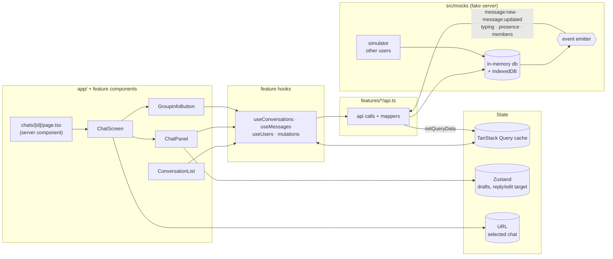

# Relay

**Live demo:** https://relay-chat-app-swart.vercel.app

A chat app inspired by WhatsApp Web and Slack: direct and group conversations, live typing, read receipts, reactions, replies and attachments. There is no backend. A mock chat server runs in the browser and simulates the other users.

Built with Next.js 16, React 19, TypeScript, Tailwind CSS 4, TanStack Query, Zustand, React Hook Form, Zod, Lucide and Vitest.

## Getting started

Requires Node 20+.

```bash
npm install
npm run dev        # http://localhost:3000
```

| Script | What it does |
|---|---|
| `npm run dev` | Start the dev server |
| `npm run build` / `npm start` | Production build and server |
| `npm test` | Run the unit tests (Vitest) |
| `npm run check` | Typecheck and lint (Biome) |

Data is saved to IndexedDB, so changes survive a reload. To reset to the seed data, clear the site data in DevTools (Application → Storage).

### Things to try

- Send a message to someone who is online. The ticks go sent → delivered → read, and they usually start typing and reply.
- Hover a message to react, reply, copy, edit or delete. Press ↑ in an empty composer to edit your last message.
- Open a group, then click the ⓘ button to see members and add or remove people.
- Open **Load test** (10,000 messages) and scroll up to load older pages.
- Use the 📎 button to attach an image or file.

## Features

**Sidebar**: avatars with online status, last message and time, unread counts, debounced search, filters (All / Unread / Groups), live "typing…" preview.

**Chat window**: send and receive, timestamps, delivery and read ticks, replies with jump-to-original, auto-scroll only when you're already at the bottom (otherwise a "New messages" button), typing indicator in the header and in the chat.

**Message actions**: edit, delete, reply, copy, one emoji reaction per user, date separators (Today / Yesterday / date).

**Groups**: info sheet with members (online status, you first), add and remove members.

**UX**: responsive (one pane on mobile, two on tablet and desktop), loading skeletons that match the real layout, empty and error states with retry, message search with match navigation, keyboard shortcuts (Enter to send, Shift+Enter for a new line, Esc to cancel reply or edit, ↑ to edit), dark and light themes.

**Optional challenges**

| Challenge | Status |
|---|---|
| Virtualized list for 10k+ messages | Done (`@tanstack/react-virtual`) |
| Optimistic sending | Done, with a failed state and retry |
| Infinite scroll for older messages | Done (`useInfiniteQuery`, 50 per page, keeps scroll position) |
| Persistence | Done: the mock server is saved to IndexedDB, drafts to localStorage |
| Debounced search | Done |
| Attachment preview | Done: images inline, files as a chip; read locally, never uploaded |
| Real-time simulation | Done with a typed event emitter that stands in for a WebSocket |
| Offline message queue | Not done |

## Architecture



Data flows in one direction: **components → hooks → `api.ts` → mock server**. Live updates come back through the emitter, and hooks write them into the query cache with `setQueryData`. One incoming message updates the open chat (messages) and the sidebar preview and unread count (conversations) at the same time.

### Folder structure

```
src/
  app/                    routes only: layout, (chat)/page, chats/[id]
  features/
    conversations/        sidebar list, search, filters, unread, chat screen + header
    messages/             message list, composer, actions, reactions, typing, search
    groups/               group info sheet, add/remove members
    users/                users with live online status (shared by messages and groups)
  mocks/                  fake server: seed data, latency, emitter, simulator, IndexedDB
  store/                  Zustand store (chat.store.ts)
  ui/primitives/          shadcn components (Base UI)
  ui/components/          shared UI: layout shell, empty/error states, theme toggle
  shared/                 hooks and utils used by 2+ features
  lib/                    query client, toast adapter, routes
```

Each feature has the same layout:

```
features/messages/
  components/   UI
  hooks/        one hook per query or mutation
  api.ts        the only file that talks to the server; maps server types to app types
  queries.ts    query keys + queryOptions
  types.ts      data model
  utils.ts      pure logic (grouping, search, formatting), unit tested
  index.ts      public API: the only file other code may import
```

Features are business capabilities, not screen areas (`messages/`, not `chat-window/`). Biome enforces the boundaries: no deep imports into another feature, components never import `src/mocks`, and `ui/`, `lib/` and `shared/` never import features.

## State management

| State | Where | Why |
|---|---|---|
| Conversations, messages, users, members | TanStack Query | Server state: caching, loading and error states, optimistic updates, pagination |
| Selected chat | URL (`/chats/[id]`) | Shareable, works with back and forward, survives a refresh |
| Drafts per chat, reply and edit targets | Zustand (`store/chat.store.ts`) | Client-only UI state shared by the list and the composer; drafts are persisted |
| Search text, active filter | `useState` | Local to one component |
| Theme | `next-themes` | Handles system preference and avoids a flash on load |

Server data is never copied into Zustand, so there is one source of truth per piece of data.

## Key decisions

- **A mock server instead of mock data in components.** `src/mocks` behaves like a backend: async calls with latency, an event stream for live updates, and a simulator for the other users. Swapping in a real API only changes each feature's `api.ts` (plus a typed HTTP client in `lib/`).
- **Mappers at the boundary.** `api.ts` converts server types (`MockMessage`) into app types (`Message`), so nothing else depends on the server's shape. There is no global normalizer: every endpoint has a known shape, and one would only add indirection.
- **Query definitions in `queries.ts`.** Keys and fetch functions live together in `queryOptions` / `infiniteQueryOptions`, so hooks, prefetching and cache updates share one definition.
- **One helper for all message cache writes.** Messages are paginated. Send, edit, delete, reactions and live events all go through `updateCachedMessages`, which keeps page boundaries intact.
- **Live events update the cache directly** instead of refetching. This mirrors how a WebSocket-backed app works and keeps optimistic messages stable.
- **Virtualization with measured rows.** Rows have variable heights (replies, attachments, reactions), so they are measured after render. The list stays pinned to the bottom while heights settle, and keeps your place when older pages load above.
- **Vendor boundaries.** Toasts go through `lib/toast.ts` (typed `success` / `error`), so the toast library can change without touching callers.

## Testing

```bash
npm test
```

87 tests across 17 files, next to the code they cover: pure utils (grouping, search, filters, formatting, reactions, the message cache), the Zustand store, hooks (optimistic send and failure, clipboard) and key components (composer keyboard behaviour, message bubble, conversation item and header, chat screen states, group panel).

## Assumptions and limitations

- There is one current user ("you"), and there is no authentication.
- Message search covers the messages loaded so far, not older pages still on the server.
- Attachments are stored as data URLs (max 5 MB) and never uploaded.
- The simulator picks random replies and toggles presence randomly, so typing and read receipts depend on who is online.
- There's no offline queue: a failed send shows a retry button instead.
